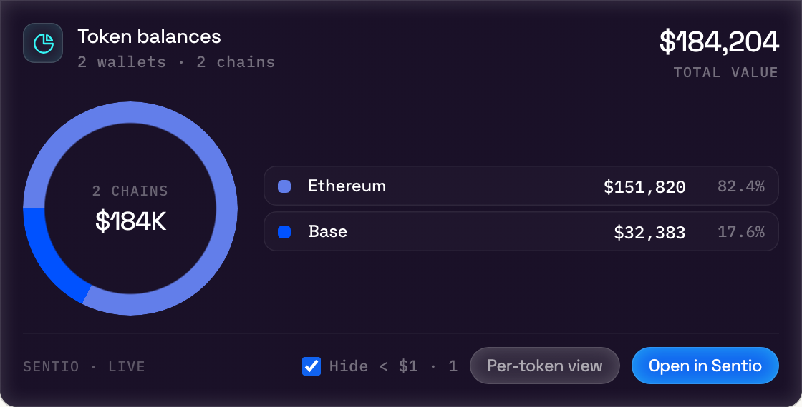
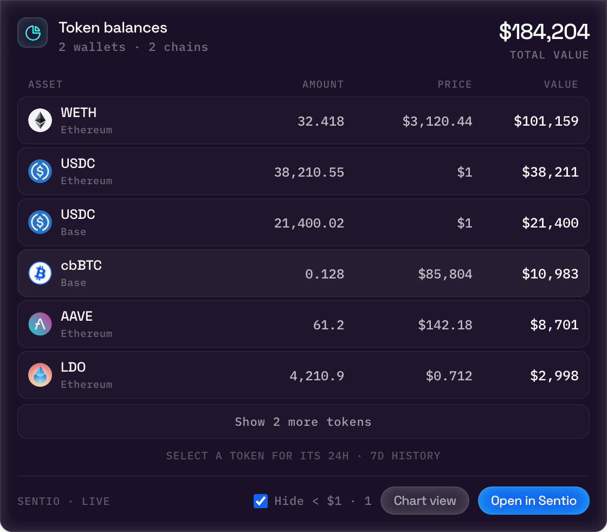
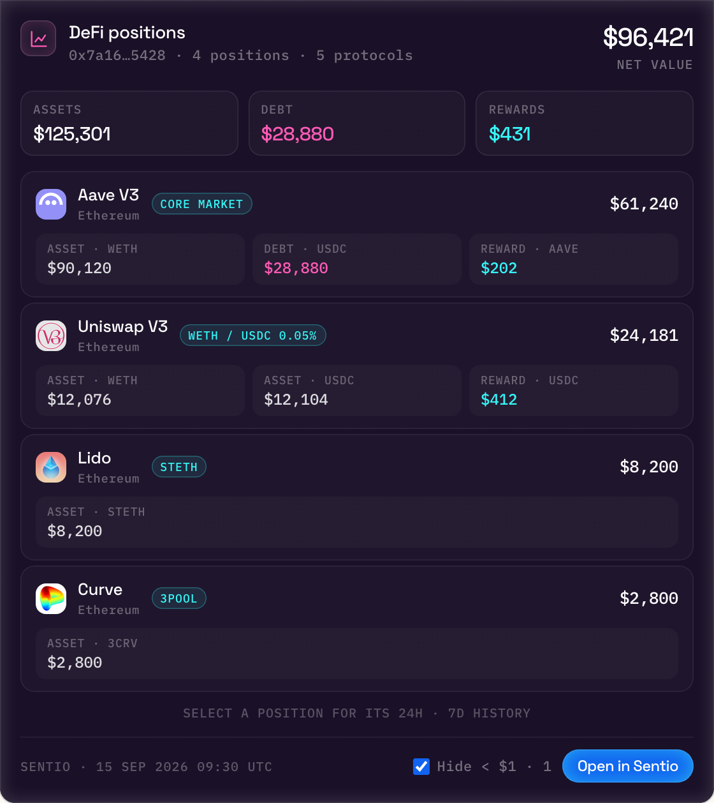
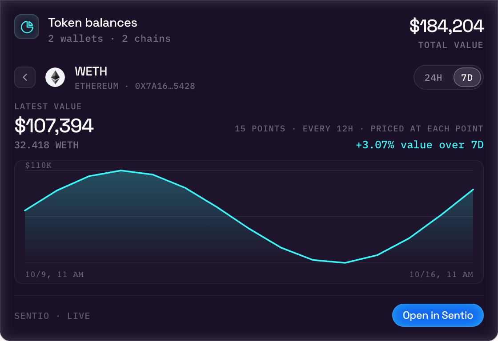

# Sentio Connect


Ask your AI assistant about any public wallet: token balances, prices, portfolio value, DeFi positions and holding history, powered by [Sentio](https://www.sentio.xyz/).

Sentio Connect is a hosted [Model Context Protocol](https://modelcontextprotocol.io) server. Add it to Claude, ChatGPT, Codex, Cursor, VS Code or any MCP client that supports Streamable HTTP and OAuth. There is nothing to install or run locally.

```text
https://connect.sentio.xyz/v1/mcp
```

<p>
  <a href="https://cursor.com/en/install-mcp?name=sentio&config=eyJ1cmwiOiJodHRwczovL2Nvbm5lY3Quc2VudGlvLnh5ei92MS9tY3AifQ=="></a>
  <a href="https://insiders.vscode.dev/redirect/mcp/install?name=sentio&config=%7B%22type%22%3A%22http%22%2C%22url%22%3A%22https%3A%2F%2Fconnect.sentio.xyz%2Fv1%2Fmcp%22%7D"></a>
</p>

## Screenshots

Interactive cards rendered inline by MCP Apps hosts (sample data).

### Token balances by chain



### Per-token balances



### DeFi positions



### Holding history (7 days)



## What you can ask

- "What is the total USD value of all the wallets I track?"
- "Show the token balances of vitalik.eth on Ethereum."
- "List my DeFi positions on Base and Arbitrum."
- "How has my USDC balance on Base changed over the last 7 days?"
- "Start tracking 0x… on Arbitrum."

## Supported chains

| Chain | ID |
| --- | --- |
| Ethereum | `1` |
| BNB Chain | `56` |
| Base | `8453` |
| Arbitrum | `42161` |
| Sui | `sui_mainnet` |

EVM addresses (`0x…`) and ENS names (`.eth`) are accepted on EVM chains; 64-hex addresses on Sui.

## Setup

On first use your client opens a Sentio Connect sign-in and consent page in the browser. After you approve, the client receives a revocable token; no API key is needed.

### Claude (claude.ai, Desktop, Mobile)

**Settings → Connectors → Add custom connector**, then paste `https://connect.sentio.xyz/v1/mcp`.

### Claude Code

```bash
claude mcp add --transport http sentio https://connect.sentio.xyz/v1/mcp
```

Then run `/mcp` inside Claude Code to sign in.

### ChatGPT

**Settings → Apps & Connectors → Create** (developer mode), set the MCP server URL to `https://connect.sentio.xyz/v1/mcp` and authentication to OAuth.

### Codex

Install the plugin, which bundles the server entry and a skill describing when to use each tool:

```text
/plugin marketplace add sentioxyz/sentio-connect
/plugin install sentio-connector@sentio
```

Or point Codex at the server directly:

```bash
codex mcp add sentio --url https://connect.sentio.xyz/v1/mcp
codex mcp login sentio
```

The plugin lives in [codex-plugin/](codex-plugin/); [.agents/plugins/marketplace.json](.agents/plugins/marketplace.json) makes this repository a Codex marketplace.

### Cursor

Click **Add to Cursor** above, or add to `~/.cursor/mcp.json`:

```json
{
  "mcpServers": {
    "sentio": { "url": "https://connect.sentio.xyz/v1/mcp" }
  }
}
```

### VS Code (GitHub Copilot)

Click **Install in VS Code** above, or add to `.vscode/mcp.json`:

```json
{
  "servers": {
    "sentio": { "type": "http", "url": "https://connect.sentio.xyz/v1/mcp" }
  }
}
```

### Cline

In the Cline panel, open **MCP Servers → Remote Servers**, enter the name `sentio` and the URL `https://connect.sentio.xyz/v1/mcp`, choose **Streamable HTTP**, and click **Add Server**. Or add this to `cline_mcp_settings.json` (**MCP Servers → Configure → Configure MCP Servers**):

```json
{
  "mcpServers": {
    "sentio": {
      "type": "streamableHttp",
      "url": "https://connect.sentio.xyz/v1/mcp",
      "disabled": false,
      "autoApprove": []
    }
  }
}
```

No API key or `headers` entry is needed: Cline opens the Sentio Connect sign-in page in the browser to authorize. See [llms-install.md](llms-install.md) for step-by-step agent instructions.

### Gemini CLI

```bash
gemini mcp add --transport http sentio https://connect.sentio.xyz/v1/mcp
```

### Other MCP clients

Point the client at `https://connect.sentio.xyz/v1/mcp` (Streamable HTTP). The server supports OAuth 2.1 discovery, dynamic client registration and PKCE, so any spec-compliant client can sign in on its own.

## Tools

| Tool | What it does |
| --- | --- |
| `get_wallet_balances` | Native and token balances valued in USD, for one wallet on one or more chains, or for every tracked wallet |
| `get_token_price` | USD spot price by symbol, or by token address and chain |
| `get_portfolio_value` | Total USD value across tracked wallets, broken down per address and chain |
| `list_wallet_addresses` | The wallet addresses you track and their chains |
| `get_defi_positions` | DeFi positions (lending, staking, LPs, rewards) for one wallet or every tracked wallet |
| `get_token_balance_history` | 24h / 7d value history of one token holding |
| `get_defi_position_history` | 24h / 7d history of one DeFi position |
| `add_wallet_address` | Start tracking a wallet address (write) |
| `remove_wallet_address` | Stop tracking a wallet address (write, destructive) |

In hosts that support [MCP Apps](https://modelcontextprotocol.io/extensions/apps), balances and DeFi positions render as interactive cards; click a row to chart its history.

## Privacy and permissions

- Sentio Connect reads **public on-chain data** only. It never asks for private keys or seed phrases and cannot move funds.
- The only data it writes is your own list of tracked wallet addresses.
- Read-only connections are supported: a client that requests only the `mcp:read` scope cannot see or call the write tools.
- You can turn individual capabilities (balances, prices, portfolio, addresses, DeFi) on or off, and revoke connected clients, at [connect.sentio.xyz](https://connect.sentio.xyz).

See the [Sentio privacy policy](https://www.sentio.xyz/privacy).

## Links

- Website: [connect.sentio.xyz](https://connect.sentio.xyz)
- Docs: [sentio.xyz/docs/connect](https://www.sentio.xyz/docs/connect)
- Official MCP Registry: `xyz.sentio/connect`
- Support: open an [issue](../../issues)

This repository holds documentation, the Codex plugin and listing assets for the hosted service; the server itself is operated by Sentio.
